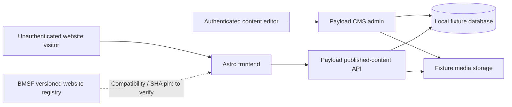

# Reference topology — Astro + Payload qualification

This describes a **candidate** reference implementation, not the approved target runtime.

**Boundaries:** Astro renders public content and never holds privileged CMS credentials in browser code. Payload owns editorial authentication, publish state, persistence and media access. Public APIs expose only published, intentionally public fields. CMS-specific editor rights must be enforced server-side. Preview is optional only when requirements call for it, with separate authorization.

For the laboratory, a local persistent SQLite dataset may be used when supported by the selected Payload release; production persistence, media storage and hosting must be selected from approved requirements, not presumed from this fixture.

**Core alternatives:** static Astro without CMS is a separate future configuration; WordPress remains separate. Payload is the approved *candidate* for this qualification path and not mandatory for all public websites.

**Recovery:** fixture seed/reset and test data cleanup first. Hosting-level rollback and DB/media backup testing is deferred to Hostinger in the final stage; no assertion of full recovery until measured.

**Unverified BMSF integration:** connector capabilities (`describe_capabilities`, `preflight`, `read_inventory`, `prepare_or_dry_run`, `apply`, `verify`, `rollback_or_compensate`, `evidence_export`) must be checked against the implemented adapter and target registry, not assumed to exist.
